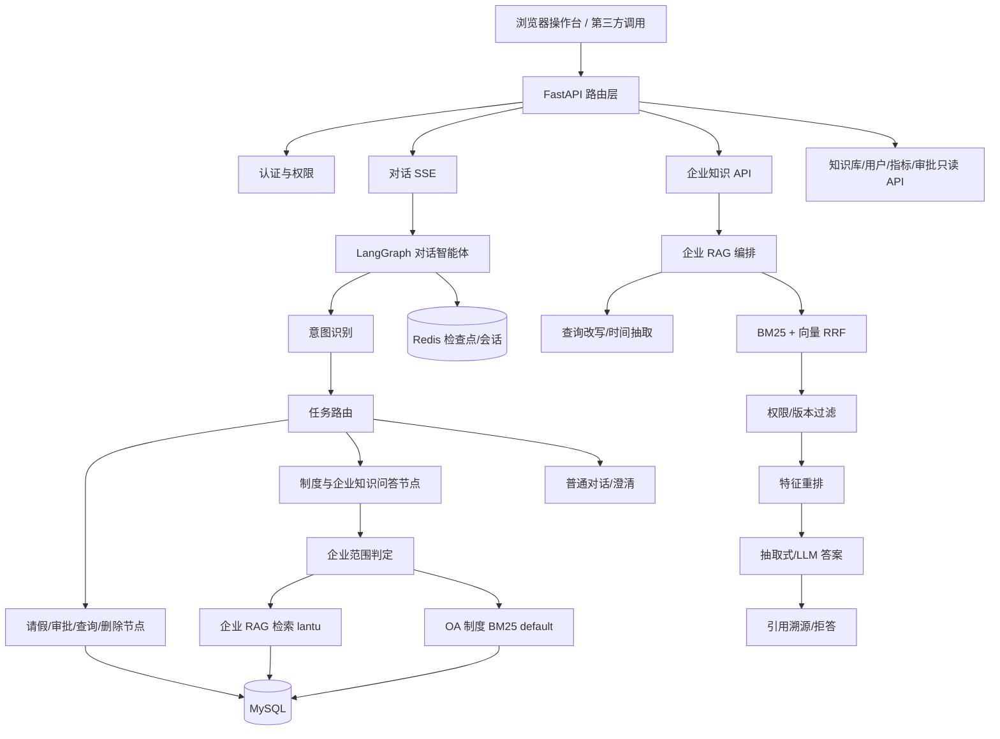
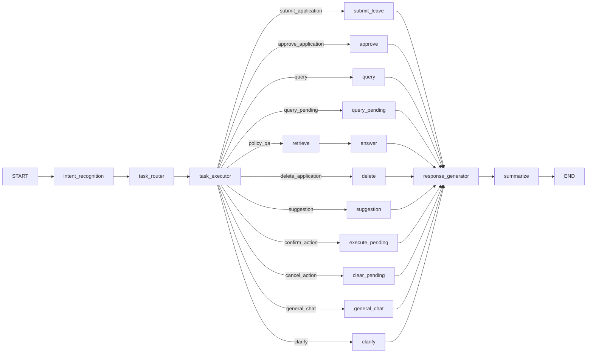

# 澜图智能企业智能体平台 — 项目技术文档

> 2026-10-21 已完成代码与运行时复核并修复。本文保留原架构设计背景；涉及默认生成模式、流式语义和历史准确率的旧描述，以 [整体评估与修复报告](项目整体评估与修复报告_20261021.md) 及当前源码、逐条实测记录为准。当前默认 hash 向量、特征重排；已配置密钥时企业问答自动启用生成，有限推理算子优先，知识输出先校验后发送。
>
> 本轮“公司名称/业务问法”专项根因、代码修改、模型切换与 62 题动态文档验收见 [推理能力修复与动态验收报告](推理能力修复与动态验收报告_20261021.md)。

**文档版本**：1.0  
**生成日期**：2026-10-21  
**对应系统版本**：3.0.0  
**项目根目录**：`<PROJECT_ROOT>`（即本文件所在目录，所有命令均在该目录执行）  
**用途**：面向项目评审、代码审查、复现测试与二次开发；可作为另一个 AI/评审者执行验收的依据。

---

## 0. 执行摘要

本项目是为虚构企业 **澜图智能装备股份有限公司（LANTU，工业机器人/智能制造）** 构建的一体化企业智能体平台，不是单一的 RAG 演示项目。系统同时包含：

| 能力域 | 实现 |
| --- | --- |
| Web 服务 | FastAPI、SSE 流式对话、统一异常与链路追踪 |
| 对话智能体 | LangGraph 状态图、意图识别、任务路由、Redis 检查点 |
| OA 业务 | JWT 登录、请假草稿确认、两级审批、取消、审计、幂等、汇报线权限 |
| 企业知识 | 134 篇企业文档、603 个文本块、12 类、5 种格式 |
| 检索增强 | 查询改写、BM25 + 向量 RRF、重排、版本冲突消解、引用溯源、拒答 |
| 制度知识 | 14 篇 OA 制度语料、75 个块，随包携带并与企业语料隔离 |
| 评测体系 | 58 项单元测试、54 条 OA 黄金集、74 条企业 RAG 用例、HTTP 冒烟与端到端验收 |
| 可移植运行 | 自带 `.venv312`、一键启动、自动建表/迁移/入库、相对路径 |

当前交付包已通过全量门禁 **ALL_CHECKS_PASS**，服务运行于 `http://127.0.0.1:8080`。企业 RAG 评测最近结果：**Recall@5 96.97%、Recall@10 98.48%、答案准确率 100%、引用覆盖率 93.94%、拒答准确率 100%**。

---

## 1. 项目背景与目标

### 1.1 企业设定

| 项目 | 内容 |
| --- | --- |
| 公司 | 澜图智能装备股份有限公司（品牌 LANTU） |
| 行业 | 工业机器人、智能产线与工业软件 |
| 成立 | 2011-06-18，苏州工业园区星澜路 88 号 |
| 规模 | 员工 3,860 人；2025 年营收 42.63 亿元；机器人出货 21,400 台 |
| 基地 | 苏州、东莞、成都，总产能 30,000 台/年 |
| 股票 | 科创板 688719（虚构） |

### 1.2 建设目标

1. 为企业员工提供统一入口：既能问公司/产品/客户/财报/制度，也能提交和审批请假。
2. 知识回答必须可追溯：每个事实句对应可核查的文档章节、版本与更新时间。
3. 同一制度存在多版本时，默认使用最新版；问题限定时间时，回退到对应生效版本。
4. 无资料支撑时明确拒答，不编造。
5. 检索与评测可离线复现；对话与自然语言回答可接入通义千问。
6. 整个项目可复制到其他文件夹直接启动，降低部署成本。

### 1.3 与早期版本的关系

早期目录中曾出现“小滴 OA”“星辰科技”等历史命名。当前交付包已完成统一：

- 用户可见品牌统一为 **澜图智能企业智能体平台**；
- 页面、健康接口、FastAPI 文档标题、助手名称、提示词全部更新；
- OA 制度语料已复制进交付包并统一为公司品牌；
- 历史数据库名 `xiaodi_smart_oa` 保留，仅作为本机兼容标识，不出现在用户界面。

---

## 2. 系统定位与总体架构

### 2.1 分层架构



### 2.2 两条主链路

**链路 A：对话入口 `/api/chat/stream`**

```
用户消息
→ 意图识别（LLM 输出 JSON）
→ 任务路由（代码映射）
→ 请假/审批/查询/删除 或 企业知识/制度问答
→ 结果生成（确定性文案或 SSE token）
→ Redis 保存消息与检查点
```

**链路 B：企业知识入口 `/api/rag/query`**

```
问题
→ 查询改写 + 同义词 + 时间抽取
→ BM25 Top60 + 哈希向量 Top60
→ RRF 融合
→ 权限过滤 + 同族版本消解
→ 特征重排 + 单文档去重
→ 句级答案拼装 / LLM 生成
→ 引用编号 + 拒答校验
→ JSON：答案、引用、检索轨迹、耗时
```

---

## 3. 技术栈与运行依赖

| 层 | 技术 |
| --- | --- |
| 语言 | Python 3.12（`.venv312`） |
| Web | FastAPI 0.115、Uvicorn 0.30、SSE |
| 智能体 | LangGraph 1.0.7、LangChain 1.x、LangGraph Redis Checkpoint |
| 模型 | 通义千问 OpenAI 兼容接口（`qwen3.8-flash`，可配置切换），可选 `text-embedding-v3` |
| 数据 | MySQL 8（业务与知识库）、Redis 8（会话/检查点/索引版本） |
| 向量 | NumPy 2.x，本地哈希向量（384 维），可选 DashScope Embedding |
| 文档解析 | python-docx、pypdf、openpyxl、csv、Markdown 解析 |
| 中文处理 | 自研二元组分词 + jieba 词性标注（仅用于未登录实体判断） |
| 测试 | unittest、HTTP 冒烟、端到端脚本、离线评测脚本 |

完整依赖见 `requirements.txt`。其中 `numpy/openpyxl/reportlab/jieba` 为本项目新增。

---

## 4. 目录结构

```
澜图智能企业智能体平台/
├── README.md                         # 用户快速使用说明
├── PROJECT_TECHNICAL_DOCUMENT.md     # 本文档
├── 启动服务.cmd / 停止服务.cmd        # 一键启停
├── 重新导入语料.cmd / 运行评测.cmd
├── 启动本地服务.py                    # 启动器：venv、WSL 数据库、迁移、入库、服务
├── main.py                           # FastAPI 入口、路由注册、健康检查
├── app/
│   ├── capabilities/
│   │   ├── retrieval/                # 分词、BM25 索引、制度检索、制度 Prompt
│   │   └── policy_engine.py          # 请假规则与校验
│   ├── core/                         # 配置、指标、限流
│   ├── database/                     # MySQL/Redis 连接池
│   ├── domain/                       # 用户、请假领域模型与状态机
│   ├── infra/                        # 事务上下文
│   ├── routes/                       # auth/chat/approvals/users/kb/metrics
│   ├── services/                     # 请假与用户服务
│   └── workflows/
│       ├── chat_agent.py             # LangGraph 主图
│       ├── chat_state.py             # 状态定义与确定性意图
│       └── chat_nodes/               # 识别、路由、请假、审批、问答、响应等节点
├── enterprise_rag/
│   ├── config.py                     # RAG 参数（环境变量）
│   ├── corpus_specs.py               # 公司/组织/产品/销售语料定义
│   ├── corpus_specs2.py              # 制度/财务/会议/法务/HR/技术/售后/战略
│   ├── corpus_gen.py                 # 生成 134 篇文档与 manifest
│   ├── corpus/                       # 语料本体与 manifest.jsonl
│   ├── loaders.py                    # md/txt/docx/pdf/csv/xlsx 解析
│   ├── chunking.py                   # 结构切分与表格切块
│   ├── embedding.py                  # 哈希向量 / DashScope
│   ├── ingest.py                     # 入库 CLI
│   ├── ensure_ingested.py            # 启动时按需入库（企业 + OA）
│   ├── store.py                      # 命名空间索引、向量矩阵、版本族
│   ├── query.py                      # 改写、同义词、时间抽取
│   ├── retrieval.py                  # 混合检索、过滤、重排、版本消解
│   ├── citations.py                  # 上下文与引用
│   ├── answer.py                     # 抽取式/LLM、意图槽位、拒答
│   ├── pipeline.py                   # 端到端编排
│   ├── api.py                        # /api/rag/*
│   └── eval/                         # 74 条测试集与报告
├── data/oa_docs/                     # 14 篇 OA 制度语料（随包携带）
├── eval/                             # OA 54 条黄金集与评测脚本
├── sql/                              # 初始化 SQL 与幂等迁移
├── tests/                            # 单元测试与 HTTP 冒烟
├── local_runtime/                    # 本机操作台、状态、检查脚本
├── .env.local                        # 本机配置（密钥、数据库、RAG 参数）
├── .env.example                      # 配置模板
└── .venv312/                         # 已安装依赖的 Python 3.12 环境
```

代码规模：95 个 Python 文件、约 10,473 行（不含虚拟环境）。

---

## 5. 数据与知识库设计

### 5.1 双命名空间

| 命名空间 | 用途 | 文档数 | 文本块 | 检索方式 |
| --- | --- | --- | --- | --- |
| `default` | OA 制度库（请假、年假、报销、离职等） | 14 | 75 | `app/capabilities/retrieval` 的 BM25 |
| `lantu` | 企业知识库（公司/产品/客户/财报/技术/售后等） | 134 | 603 | `enterprise_rag` 混合检索 |

两个命名空间通过 `kb_documents.namespace` 与索引缓存隔离，不会互相串答。企业知识问题优先查 `lantu`，明确的 OA 制度/流程问题回退 `default`。

### 5.2 企业语料构成

- 文档：134 篇；文本块：603 个。
- 12 类：company 8、org 9、product 15、sales 18、policy 16、finance 11、meeting 10、legal 8、hr 10、tech 10、support 12、strategy 7。
- 5 种格式：md 112、docx 10、pdf 5、xlsx 4、csv 3。
- 6 组同族多版本（13 篇）：差旅（v1/v2/v3）、考勤、采购、销售折扣、组织架构、服务 SLA。

### 5.3 元数据规范

每篇文档在 `manifest.jsonl` 与数据库中都包含：

| 字段 | 含义 |
| --- | --- |
| `doc_id` | 稳定文档 ID，如 `lantu_policy_travel_2025h2` |
| `title` | 标题 |
| `namespace` | `lantu` / `default` |
| `category` | 12 类之一 |
| `department` / `author` | 所属部门、作者 |
| `doc_family` / `version` | 文档族与版本号 |
| `created_at` / `updated_at` | 创建/更新时间 |
| `effective_date` | 生效日期 |
| `format` / `visibility` / `status` | 格式、可见性、状态 |
| `path` / `checksum` / `size_bytes` | 源文件、SHA-256、大小 |

Markdown/DOCX/PDF 正文首部会展示元数据块；入库时 loader 会过滤该块，避免“更新时间/部门”等词污染检索，事实以数据库字段为准。

### 5.4 多格式处理

| 格式 | 解析方式 |
| --- | --- |
| md/txt | 按 Markdown 标题与中文“一、二、”标题分节 |
| docx | 段落按 Heading 分节，表格转管道文本 |
| pdf | pypdf 提取文本，再按标题分节 |
| csv | UTF-8-SIG 读取，首行表头，统一渲染为管道表格 |
| xlsx | openpyxl 逐工作表读取，跳过“文档信息”，每表独立分节 |

### 5.5 切分策略

- 文本：按章节与句子打包，单块最大 480 字，块间重叠 70 字，过短尾块并入上一块。
- 表格：每 10 行为一块，每块重复表头，保证“价格/参数/金额”等行可独立检索。
- 前缀：每个块写入“文档标题 · 章节”，增强块级可读性与标题匹配。
- 块类型：`text` / `table`，供重排时对表格类问题加分。

### 5.6 语料生成与重建

```powershell
# 重新生成 134 篇文档（覆盖 enterprise_rag/corpus/docs 与 manifest）
.\.venv312\Scripts\python.exe -m enterprise_rag.corpus_gen

# 全量重建 lantu 命名空间
.\.venv312\Scripts\python.exe -m enterprise_rag.ingest

# 抽样验收（不清理已有数据）
.\.venv312\Scripts\python.exe -m enterprise_rag.ingest --limit 10
```

---

## 6. 企业 RAG 模块详解

### 6.1 向量化

默认 `RAG_EMBEDDING_PROVIDER=hash`：

- 特征：中文二元组（继承自 `tokenizer`）+ 汉字三元组（权重 0.6）+ ASCII 词。
- 哈希：BLAKE2b 映射到 384 维，符号哈希，子线性词频 `1 + ln(tf)`。
- 归一化：L2 归一化，存入 `kb_chunks.embedding_json`。
- 优点：无外网、完全可复现；缺点：不具备深度语义泛化，跨表述依赖同义词表。

切换 `RAG_EMBEDDING_PROVIDER=dashscope` 可调用通义千问 `text-embedding-v3`，失败时自动回退哈希向量。

### 6.2 索引

`enterprise_rag/store.py` 按命名空间加载：

- 全量块 + 文档元数据。
- 进程内 BM25 索引（复用 OA 的 `BM25Index`）。
- NumPy 向量矩阵（`N × 384`）。
- 文档族 → 文档列表映射。
- 词项 IDF 表与语料全文（用于未登录实体校验）。
- 索引版本来自 Redis `rag_index_version:lantu`，入库后自动失效重载。

### 6.3 查询改写与时间抽取

`enterprise_rag/query.py`：

- 同义词/缩写扩展：出差→差旅/住宿/补贴、SLA→服务等级协议、AMR→自主移动机器人、归母净利润→净利润、公司叫什么→公司名称/全称等。
- 时间抽取：
  - `2025年7月` → `2025-07-31`
  - `2025年第三季度` → `2025-09-30`
  - `2025年上半年` → `2025-06-30`
  - `2024年` → `2024-12-31`
- 生成改写问题、命中同义词、时间标签，供检索与响应追踪。

### 6.4 混合召回与融合

- BM25：`CANDIDATE_K=60`。
- 向量：余弦相似度 Top60。
- RRF：`score = w_bm25/(k+rank_bm25) + w_vec/(k+rank_vec)`，默认 `k=60`、双权重 1.0。
- 权限：企业语料默认全员可见；`manager/hr/finance/admin` 可见性仍按 OA 规则收敛；部门字段只作元数据，不拦截企业文档。
- 版本消解：同族多版本先按 `doc_updated_at`/版本号选最新；有 `as_of` 时按 `effective_date <= as_of` 选对应版本，再做融合与重排。

### 6.5 重排

对融合候选计算：

| 特征 | 权重/加分 |
| --- | --- |
| IDF 加权词覆盖 | 0.40 |
| 向量相似度 | 0.30 |
| 标题/章节命中 | 0.15 |
| 短语命中 | 0.10 |
| 表格问题 + 表格块 | +0.05 |
| 型号/实体命中 | 最高 +0.20 |
| 数字意图（金额/台数/时间等） | +0.08 |
| 年份匹配/不匹配 | ±0.06 |
| 精确年月/季度匹配 | +0.16 |
| 同族最新版 | +0.03 |

之后按文档去重，单文档最多 4 块，输出 Top8。

### 6.6 答案生成与拒答

默认抽取式（`RAG_USE_LLM=false` 的离线模式；有密钥时默认 `auto` 走生成）：

1. 取 Top8 块；按句子（句号/问号/感叹号/换行）切分，合并被 PDF 换行打断的句子。
2. 句级打分：覆盖率 + 数字/单位/实体/成效/时间等意图槽位。
3. 必要槽位：数量、成效、时长、等级、地点、比例、参数、公司身份、使命/愿景、董事会分红、销售合同预付款、出口管制、折扣审批等。
4. 最多保留 4 句，优先保留槽位句；按文档与数字签名去重。
5. 生成“根据企业知识库资料：…… [n]”的答案。
6. 拒答门禁：
   - 最高块分 < `RAG_MIN_SCORE=0.18`；
   - 句级置信度 < 0.28；
   - 无有效引用；
   - 问题中的名词性未登录实体（如“印度”“世界杯”“收盘价”）在前三块中不存在。
7. 引用重编号，输出 `citations`。

可选 LLM 模式：`RAG_USE_LLM=true` 或 API `use_llm=true`，以同一上下文生成 260 字内答案，并校验 `[n]` 引用；失败自动回退抽取式。

### 6.7 引用与溯源

每条引用包含：

`doc_id`、`chunk_id`、`title`、`section`、`department`、`author`、`version`、`format`、`effective_date`、`doc_updated_at`、`source_path`、`snippet`、`score`、`vector_score`。

API 还返回检索轨迹：每块的 `bm25_rank`、`vector_rank`、`rrf_score`、`features`。

### 6.8 对话联动

`app/workflows/chat_nodes/enterprise_scope.py` 判定问题范围：

- 企业主题（公司/产品/客户/研发/售后/财报/战略等）或公司身份问句 → `lantu`。
- 明确的 OA 制度/流程（请假、年假、报销、发票、离职、试用期、食堂等）→ `default`，避免企业文档覆盖 OA 规则。

`policy_qa.py` 先尝试企业混合检索；没有超过阈值的块时回退 OA 制度 BM25。模型把企业问题识别为 `general_chat` 时，`routing.py` 会强制改走 `policy_qa`。最终回复使用确定性文案，避免二次改写丢失引用。

---

## 7. OA 与对话智能体子系统

### 7.1 认证与用户上下文

- `/api/auth/login`：用户名/密码（bcrypt）→ JWT。
- `get_user_context`：服务端从数据库用户构造 `UserContext`，权限判断只信任该对象。
- 角色：`employee`、`manager`、`finance`、`hr`、`admin`。
- 演示账号：`admin`、`employee_zhao`、`employee_qian`、`manager_zhang`、`manager_li`、`finance_wang`、`hr_liu`，密码均为 `admin123`。

### 7.2 LangGraph 主图



允许意图：`submit_leave`、`delete_application`、`approve`、`query_status`、`query_pending`、`policy_qa`、`get_suggestion`、`confirm_action`、`cancel_action`、`general_chat`、`clarify`。

### 7.3 两阶段确认与幂等

- 提交请假、审批、取消均为“先草稿、后确认”：首次返回待确认动作，用户回复“确认”才执行。
- 写操作支持 `idempotency_key`，相同键返回缓存响应。
- 审批使用乐观锁（`version` + `expected_status/step`），并发冲突返回 `CONFLICT`。
- 审计表 `approval_audit` 只追加，记录 submit/approve/reject/cancel 与 trace_id。

### 7.4 请假状态机

状态：`pending` → `approved` / `rejected` / `cancelled` / `finished`。  
环节：`manager` → `hr` → `done`。

- 年假超过 3 个工作日需要 HR 二级审批；其他类型或 ≤3 天由主管审批后结束。
- 主管审批权限：
  - 有汇报线：必须为申请人的 `manager_id`；
  - 未配置汇报线：回退到同部门主管；
  - 管理员可审批；本人不能审批自己的申请。
- HR 环节必须由 HR 角色审批。
- 取消：仅申请人本人、且仍处于 pending。
- 报销/离职表结构保留，但当前主闭环只实现请假审批。

### 7.5 流式协议

`POST /api/chat/stream` 返回 SSE：

| 事件 | 含义 |
| --- | --- |
| `start` | 返回 thread_id |
| `status` | understanding / generating |
| `token` | 增量文本 |
| `complete` | 完整响应、intent、citations、pending_action、last_result |
| `error` | 处理失败 |

会话与消息由 Redis Checkpoint 保存；`/api/chat/history` 读取历史，`/api/chat/sessions` 列出会话。

### 7.6 防护

- 提示词注入规则拦截（忽略指令、系统提示词、批量批准等）。
- 限流：默认 60 次/5 分钟，本机 `.env.local` 放宽到 200。
- 所有写操作必须经过确认，模型不能直接执行。
- 制度问答引用校验失败时降级为拒答。

---

## 8. 数据库设计

数据库：`xiaodi_smart_oa`（历史兼容名，内部使用）。表：

| 表 | 作用 |
| --- | --- |
| `users` | 账号、角色、部门、职位、直属主管 |
| `leave_applications` | 请假申请、两级审批、版本号、幂等键 |
| `reimbursement_applications` | 报销申请表（结构保留） |
| `resignation_applications` | 离职申请表（结构保留） |
| `approval_audit` | 审批审计流水 |
| `idempotency_keys` | 写操作幂等缓存 |
| `kb_documents` | 文档元数据、命名空间、版本族、时间、格式 |
| `kb_chunks` | 文本块、表类型、向量 JSON、向量维度 |

迁移 004 新增：

- `kb_documents`：`namespace`、`author`、`doc_family`、`category`、`format`、`doc_created_at`、`doc_updated_at`；
- `kb_chunks`：`chunk_type`、`embedding_json`、`embedding_dim`；
- 索引：`idx_namespace_status`、`idx_doc_family`。

迁移入口：`sql/apply_migrations.py`（幂等）；新库初始化：`sql/init_mysql.sql`。

---

## 9. API 参考

所有接口默认需要 `Authorization: Bearer <token>`，除 `/api/health`、`/api/ready`、`/local/status`、`/` 和登录接口。

### 9.1 认证

| 方法 | 路径 | 说明 |
| --- | --- | --- |
| POST | `/api/auth/login` | 登录，返回 token 与用户信息 |
| GET | `/api/auth/profile` | 当前用户 |

### 9.2 对话

| 方法 | 路径 | 说明 |
| --- | --- | --- |
| POST | `/api/chat/session` | 新建会话 |
| GET | `/api/chat/sessions` | 我的会话 |
| GET | `/api/chat/history?thread_id=` | 历史消息 |
| DELETE | `/api/chat/session/{thread_id}` | 删除会话 |
| POST | `/api/chat/stream` | SSE 对话 |

请求：

```json
{"thread_id":"chat_xxx","user_message":"公司叫什么名字？"}
```

### 9.3 企业知识

| 方法 | 路径 | 说明 |
| --- | --- | --- |
| POST | `/api/rag/query` | 问答 |
| GET | `/api/rag/stats` | 语料统计 |
| GET | `/api/rag/documents` | 文档目录（管理员） |
| POST | `/api/rag/reindex` | 刷新索引（管理员） |
| GET | `/api/rag/eval/latest` | 最近评测报告 |

请求：

```json
{"question":"2024年一线城市差旅住宿标准是多少？","top_k":8,"as_of":null,"use_llm":false}
```

响应核心字段（示例已截断）：

```json
{
  "answer": "根据企业知识库资料：一线城市住宿标准 450 元/晚…… [1]。",
  "grounded": true,
  "refused": false,
  "citations": [{"index":1,"doc_id":"lantu_policy_travel_2024","title":"澜图智能差旅费用报销标准（2024版）","section":"一、住宿标准","version":"v1.0"}],
  "query_rewrite": {"original":"……","rewritten":"……","as_of":"2024-12-31"},
  "retrieval": {"chunks":[{"title":"……","score":0.69,"bm25_rank":1,"vector_rank":2}]},
  "latency_ms": 15
}
```

### 9.4 审批、用户、知识库运维

| 方法 | 路径 | 权限 |
| --- | --- | --- |
| GET | `/api/approvals/pending` | 主管/HR/管理员 |
| POST | `/api/approvals/{app_id}/suggestion` | 主管/HR/管理员 |
| GET | `/api/approvals/{app_id}/audit` | 本人/主管/HR/管理员 |
| GET | `/api/users` | 管理员 |
| PUT | `/api/users/{username}/manager` | 管理员 |
| GET | `/api/kb/documents` | 管理员 |
| PATCH | `/api/kb/documents/{doc_id}` | 管理员 |
| GET | `/api/kb/stats` | 管理员 |
| POST | `/api/kb/reindex` | 管理员 |
| GET | `/api/kb/search` | 管理员 |

请假写操作没有独立 REST 接口，统一通过对话“草稿 → 确认”执行，以保证审计与防误操作。

### 9.5 可观测性

| 方法 | 路径 | 说明 |
| --- | --- | --- |
| GET | `/api/health` | 版本与运行状态 |
| GET | `/api/ready` | MySQL/Redis/知识库就绪 |
| GET | `/api/metrics` | 内存指标（管理员） |
| GET | `/local/status` | 本机模型与运行状态 |
| GET | `/` | 本机操作台 |

---

## 10. 配置、启动与可移植性

### 10.1 关键环境变量（`.env.local`）

| 变量 | 默认 | 说明 |
| --- | --- | --- |
| `OPENAI_API_KEY` / `OPENAI_API_BASE` / `OPENAI_MODEL` | — | 对话与 LLM 回答 |
| `MYSQL_HOST/PORT/USER/PASSWORD/DATABASE` | 本地 | 业务与知识库 |
| `REDIS_URL` | `redis://127.0.0.1:6379/0` | 会话/检查点/索引版本 |
| `SECRET_KEY` | — | JWT 签名 |
| `CHAT_RATE_LIMIT` / `CHAT_RATE_WINDOW_SECONDS` | 60/300 | 本机为 200/300 |
| `RAG_NAMESPACE` | `lantu` | 企业语料命名空间 |
| `RAG_TOP_K` / `RAG_CANDIDATE_K` | 8/60 | 输出与召回规模 |
| `RAG_RRF_K` | 60 | RRF 平滑参数 |
| `RAG_MAX_CHUNKS_PER_DOC` | 4 | 单文档块上限 |
| `RAG_MIN_SCORE` | 0.18 | 拒答阈值 |
| `RAG_EMBEDDING_PROVIDER` | `hash` | `hash`/`dashscope` |
| `RAG_EMBEDDING_DIM` | 384 | 向量维度 |
| `RAG_USE_LLM` | `false` | 默认抽取式 |

`.env.local` 含真实密钥与数据库口令，**不得公开上传**。

### 10.2 一键启动

双击 `启动服务.cmd`，或：

```powershell
.\.venv312\Scripts\python.exe 启动本地服务.py --background --no-browser
```

启动器执行：

1. 检查 `.venv312`（缺失则创建并安装依赖）；
2. 启动 WSL 中的 MySQL/Redis；
3. `setup_database.py` 建表并保留已有数据；
4. `sql/apply_migrations.py`；
5. `enterprise_rag.ensure_ingested`：企业语料 134 篇 + OA 语料 14 篇按需入库；
6. 模型配置检查；
7. Uvicorn 启动并写日志到 `local_runtime/logs/backend.log`。

停止：

```powershell
.\.venv312\Scripts\python.exe 启动本地服务.py --stop
```

### 10.3 可移植性

- 目录内全部代码使用相对路径；实测整体重命名/移动到其他文件夹后可直接启动。
- 同机复制：保留 `.venv312` 即可。
- 跨机复制：删除 `.venv312`，首次启动自动创建环境并安装依赖。
- 数据库要求 MySQL/Redis；默认使用本机 WSL，或修改 `.env.local` 指向可用实例。

---

## 11. 测试与评估体系

### 11.1 分层测试

| 层级 | 内容 | 命令 |
| --- | --- | --- |
| 单元测试 | 状态机、权限、检索、答案校验、RAG 纯函数、范围判定 | `python -m unittest discover -s tests -t . -q` |
| OA 检索评估 | 54 条黄金集 Recall@5/MRR/关键词覆盖 | `python eval/run_eval.py --gate` |
| OA 回答抽样 | 5 条 LLM 回答与引用覆盖 | `python eval/run_eval.py --answers 5 --gate` |
| 企业 RAG 评估 | 74 条，8 类场景，门槛校验 | `python -m enterprise_rag.eval.run_eval --gate` |
| HTTP 冒烟 | 鉴权、对话、审批、知识库、RAG、注入防护 | `python scripts/run_checks.py --http` |
| 端到端 | 真实 MySQL/Redis/LLM 流程 | 同上（`--http`） |

### 11.2 单元测试

当前 **58 项全部通过**，覆盖：

- Phase 0：权限、状态机、幂等、审计；
- Phase 1：切分、BM25、引用校验、拒答；
- 限流、摘要；
- 企业 RAG：时间抽取、同义词、切分、向量确定性/归一化、版本消解、企业/OA 范围判定。

### 11.3 OA 黄金集

54 条问题，最近结果：

- Recall@5：**100%**
- Top1 文档命中：**100%**
- MRR：**1.0**
- 关键词覆盖：**100%**
- 5 条回答抽样引用覆盖：**100%**

### 11.4 企业 RAG 评测集（74 条）

| 类别 | 数量 | 场景 |
| --- | --- | --- |
| single_doc | 16 | 公司名称/简介/总部/使命、产品参数、制度条款 |
| multi_doc | 10 | 方案+案例、财报+研发、战略+预算 |
| cross_department | 8 | 财务/HR/法务/供应链/质量综合 |
| conflict | 8 | 同族版本默认最新 |
| time_range | 8 | 2024 版、2025 年 1 月/7 月、Q3、上半年 |
| fuzzy | 8 | 同义词、口语化、缩写 |
| cross_format | 8 | CSV/XLSX/PDF/DOCX/长文表格 |
| refusal | 8 | 无依据问题必须拒答 |

指标定义：

- **Recall@K**：Top-K 块所属文档中是否出现任一期望文档。
- **全量召回@10**：多文档问题的所有期望文档是否都在 Top10。
- **MRR**：首个期望文档排名倒数。
- **nDCG@10**：二值相关性归一化折损累计增益。
- **答案准确率**：答案包含全部标准关键词（数字去空格/逗号后匹配）。
- **引用覆盖率**：引用文档命中期望文档的比例。
- **拒答准确率**：拒答类正确拒答比例。
- **误拒率**：可回答问题被拒答比例。

最近结果：

| 指标 | 数值 |
| --- | --- |
| Recall@5 | **96.97%** |
| Recall@10 | **98.48%** |
| 全部期望文档命中 Top10 | **93.94%** |
| MRR | **0.8477** |
| nDCG@10 | **0.8651** |
| 答案准确率 | **100%** |
| 引用覆盖率 | **93.94%** |
| 有依据回答率 | **100%** |
| 拒答准确率 | **100%** |
| 非拒答误拒率 | **0%** |
| 平均延迟 | **约 12–26 ms（进程内）** |

逐条结果：`enterprise_rag/eval/reports/per_case.jsonl`；报告：`enterprise_rag/eval/reports/report.md`。

### 11.5 HTTP 冒烟与端到端

`scripts/run_checks.py --http` 依次执行：

1. 58 项单元测试；
2. OA 检索 + 5 条回答评估；
3. 企业 RAG 74 条评估门槛；
4. KB E2E（制度问答、拒答、历史）；
5. 请假 E2E（草稿、提交、取消、两级审批、历史）；
6. 两级审批、汇报线、审批 API、建议、主管快照、用户管理、知识库管理；
7. 企业 RAG API 冒烟（品牌、鉴权、冲突、时间范围、拒答、模糊、公司问答、文档目录、重建索引）；
8. 提示词注入防护。

最近一次输出：**ALL_CHECKS_PASS**。

### 11.6 浏览器验收

已实际打开 `http://127.0.0.1:8080/`：

- 页面标题/页头显示“澜图智能企业智能体平台”，无“小滴”；
- `employee_qian` 登录成功；
- 发送“公司叫什么名字？”返回“澜图智能装备股份有限公司”；
- 引用包含“澜图智能装备公司简介 · 一、公司概况（v5.2）”；
- 非拒答。

---

## 12. 结果分析与系统边界

### 12.1 优势

1. **双命名空间隔离**：企业知识与 OA 制度不互相污染。
2. **版本冲突可解释**：默认最新、时间限定回退，且有评测覆盖。
3. **引用可追溯**：答案句级引用文档、章节、版本、更新时间、源路径。
4. **拒答有门禁**：块分、句分、未登录实体三重校验，8 条拒答用例全部正确。
5. **离线可复现**：哈希向量 + 抽取式答案，无需外网即可跑完整评测。
6. **业务闭环**：从登录、提问、请假草稿、确认、两级审批、审计到历史均可运行。
7. **可移植**：自带运行环境、语料、启动器与自动初始化。

### 12.2 已知限制

| 限制 | 说明 |
| --- | --- |
| 哈希向量语义弱 | 跨表述依赖同义词表；切换 DashScope 可改善 |
| 抽取式答案可读性 | 默认答案由原文句子拼接，可能包含多余句；LLM 模式可改善 |
| 答案准确率口径 | 100% 是测试集关键词完全匹配，不等同于人工语义评分 |
| 多文档完整召回 | 93.94%，仍有少量用例只命中部分期望文档 |
| 模糊/跨格式 Recall@5 | 均为 87.5%，部分依赖 Top10 或相邻块 |
| 对话依赖 LLM | 意图识别与自然语言回答需要模型 API；RAG API/离线评测不需要 |
| 运行环境 | 本机依赖 WSL MySQL/Redis；跨机需准备数据库或修改配置 |
| 历史数据库名 | `xiaodi_smart_oa` 为兼容标识，用户界面不展示 |
| 未实现范围 | 无前端工程化构建、SSO、多租户计费、报销/离职完整审批流 |

### 12.3 适用与不适用场景

适用：企业内部知识问答、制度查询、请假审批演示、RAG 方案评测、可追溯引用场景。  
不适用：高并发生产、强合规金融场景、需要深度语义泛化但无同义词维护的场景。

---

## 13. 供另一个 AI 评审/测试的操作指南

### 13.1 评审前检查

1. 确认当前目录为项目根目录（`main.py` 与 `README.md` 所在目录）。
2. 确认服务：浏览器打开 `http://127.0.0.1:8080/`，或请求 `/api/health`，应返回 `version: 3.0.0` 与“澜图智能企业智能体平台运行中”。
3. 确认数据：`/api/rag/stats` 应返回 `documents=134`、`chunks=603`、`versioned_families=6`。
4. 不要公开 `.env.local` 中的密钥。

### 13.2 推荐测试顺序

```powershell
cd "<PROJECT_ROOT>"

# 1) 单元测试，预期 Ran 58 tests, OK
.\.venv312\Scripts\python.exe -m unittest discover -s tests -t . -q

# 2) 企业 RAG 离线评测，预期 gate passed=true
.\.venv312\Scripts\python.exe -m enterprise_rag.eval.run_eval --gate

# 3) OA 检索评测（离线，不调用 LLM）
.\.venv312\Scripts\python.exe eval\run_eval.py --gate

# 4) OA 回答抽样（需要模型网络）
.\.venv312\Scripts\python.exe eval\run_eval.py --answers 5 --gate

# 5) HTTP 冒烟（需要服务在线；会写入并清理临时数据）
.\.venv312\Scripts\python.exe tests\smoke_rag.py

# 6) 全量门禁（包含上述与 E2E）
.\.venv312\Scripts\python.exe scripts\run_checks.py --http
```

### 13.3 关键人工用例与预期

| # | 问题 | 预期 |
| --- | --- | --- |
| 1 | 公司叫什么名字？ | 回答含“澜图智能装备股份有限公司” |
| 2 | 澜图智能是一家什么公司？ | 含“工业机器人”“智能制造” |
| 3 | 公司总部在哪里？ | 含“苏州工业园区”“星澜路88号” |
| 4 | 2025年7月之后一线城市差旅住宿标准是多少？ | 含“600 元/晚” |
| 5 | 2024年一线城市差旅住宿标准是多少？ | 含“450 元/晚”，`as_of=2024-12-31` |
| 6 | 销售折扣审批权限如何划分？ | 含 8%、15%、25%、董事会 |
| 7 | 恒芯动力电池项目用了多少台机器人，成效如何？ | 含 186 台、42%、99.3% |
| 8 | 2025年12月的营业收入是多少？ | 含 4.90 亿元 |
| 9 | 2025年第三季度订单金额是多少？ | 含 13.6 亿元 |
| 10 | 半导体晶圆搬运方案的洁净等级是多少？ | 含 Class 10 |
| 11 | 公司食堂今天中午的菜单是什么？ | 明确拒答，无引用 |
| 12 | 创始人顾承澜的生日是哪一天？ | 明确拒答，无引用 |

可直接调用 API：

```powershell
$token = (Invoke-RestMethod -Method Post -Uri http://127.0.0.1:8080/api/auth/login `
  -ContentType application/json -Body '{"username":"employee_qian","password":"admin123"}').data.token

Invoke-RestMethod -Method Post -Uri http://127.0.0.1:8080/api/rag/query `
  -Headers @{Authorization="Bearer $token"} -ContentType application/json `
  -Body '{"question":"公司叫什么名字？","top_k":8}'
```

### 13.4 验收清单

| 验收项 | 证据 | 通过标准 |
| --- | --- | --- |
| 系统品牌 | `GET /`、`GET /api/health` | 显示“澜图智能企业智能体平台”，无“小滴” |
| 公司身份问答 | 对话/`/api/rag/query` | 返回公司全称、总部与引用 |
| 文档规模 | `/api/rag/stats` | 134 文档/603 块 |
| 多格式 | `enterprise_rag/corpus/docs` | md/docx/pdf/csv/xlsx 均存在并可检索 |
| 版本冲突 | 差旅/折扣/SLA 问题 | 默认最新；指定年份回退 |
| 时间范围 | 2024 vs 2025 问题 | 返回对应版本数值 |
| 混合检索 | `/api/rag/query` 的 `retrieval.chunks` | 含 bm25/vector 排名与 features |
| 引用 | 响应 `citations` | 文档、章节、版本、更新时间齐全 |
| 拒答 | 无依据问题 | `refused=true`、无 citations |
| 权限 | employee 查 `/api/rag/documents` | 403 |
| 审批闭环 | `scripts/run_checks.py --http` | `ALL_CHECKS_PASS` |
| 可移植 | 复制/移动目录后启动 | 服务可用、数据自动检查 |

### 13.5 测试数据副作用

- `smoke_kb_admin.py` 会插入临时文档并在 finally 删除。
- 请假 E2E 会创建真实请假记录（部分取消、部分审批），用于验证状态机。
- 如需完全干净的环境：停止服务、新建数据库并重新运行 `启动服务.cmd`，但会丢失现有演示数据。
- 评测脚本只读知识库，不修改文档；`/api/rag/reindex` 只刷新内存索引。

---

## 14. 运维与故障排查

| 现象 | 排查 |
| --- | --- |
| 页面打不开 | 查看 `local_runtime/logs/backend.log`，确认 8080 端口 |
| MySQL/Redis 未就绪 | 确认 WSL `Ubuntu-24.04` 可用，或修改 `.env.local` 指向现有实例 |
| 模型 401 | 更新 `.env.local` 的 `OPENAI_API_KEY`，重启服务 |
| 公司问题仍拒答 | 检查 `/api/rag/stats` 是否为 134/603，检查 `.env.local` 的 `RAG_NAMESPACE=lantu` |
| 文档更新未生效 | 运行 `重新导入语料.cmd` 或 `/api/rag/reindex` |
| 评测门槛失败 | 查看 `enterprise_rag/eval/reports/report.md` 的失败与逐条表 |
| 复制后启动失败 | 删除 `.venv312` 后重新启动，等待依赖安装 |
| 审批无权限 | 检查 `users.manager_id` 汇报线；未配置时按部门回退 |

---

## 15. 附录

### 15.1 演示账号

| 账号 | 角色 | 部门 |
| --- | --- | --- |
| `admin` | 管理员 | 管理部 |
| `employee_zhao` / `employee_qian` | 员工 | 技术部 |
| `manager_zhang` | 主管 | 技术部 |
| `manager_li` | 主管 | 财务部 |
| `finance_wang` | 财务 | 财务部 |
| `hr_liu` | HR | 人事部 |

密码均为 `admin123`。

### 15.2 关键文档 ID（用于引用核对）

| 主题 | doc_id |
| --- | --- |
| 公司简介 | `lantu_company_profile` |
| 使命愿景 | `lantu_company_mission` |
| 差旅 2024 / 2025 / 2025-07 | `lantu_policy_travel_2024` / `lantu_policy_travel_2025` / `lantu_policy_travel_2025h2` |
| 销售折扣 2025 | `lantu_sales_discount_2025` |
| SLA 2025 | `lantu_support_sla_2025` |
| 2025 年报 | `lantu_finance_annual_2025` |
| 恒芯案例 | `lantu_case_01_hengxin` |
| 半导体方案 | `lantu_solution_semiconductor` |
| 月度经营数据 | `lantu_finance_monthly_2025` |

### 15.3 报告与验收证据

| 证据 | 路径 |
| --- | --- |
| 企业 RAG 报告 | `enterprise_rag/eval/reports/report.md` |
| 企业逐条结果 | `enterprise_rag/eval/reports/per_case.jsonl` |
| 企业指标 JSON | `enterprise_rag/eval/reports/latest.json` |
| OA 评测报告 | `eval/reports/latest.json` |
| 语料清单 | `enterprise_rag/corpus/manifest.jsonl` |
| 启动日志 | `local_runtime/logs/backend.log` |
| 模型检查 | `local_runtime/model_check.json` |
| 知识库验收 | `local_runtime/verification_kb.json` |

### 15.4 术语

| 术语 | 含义 |
| --- | --- |
| 命名空间 | 知识库隔离单位：`default`（OA）/`lantu`（企业） |
| 文档族 | 同一制度的不同版本集合，如 `travel_expense` |
| RRF | Reciprocal Rank Fusion，按排名融合多路召回 |
| BM25 | 关键词相关性打分 |
| 抽取式答案 | 从原文句子中选择并拼接答案 |
| 拒答 | 无资料支撑时明确说明未覆盖 |
| SSE | Server-Sent Events，流式输出 |

---

## 16. 当前状态与结论

- 系统版本：3.0.0
- 运行地址：`http://127.0.0.1:8080`
- 企业语料：134 篇 / 603 块
- OA 制度语料：14 篇 / 75 块
- 单元测试：58 项通过
- 企业 RAG：74 条评测通过，答案准确率 100%，拒答准确率 100%
- OA 检索：54 条全部命中
- 全量 HTTP 门禁：`ALL_CHECKS_PASS`
- 浏览器验收：品牌、登录、公司问答、引用均通过

本文档与代码、测试报告保持同步；如后续修改语料、阈值或接口，应同步更新本文档与评测报告。
