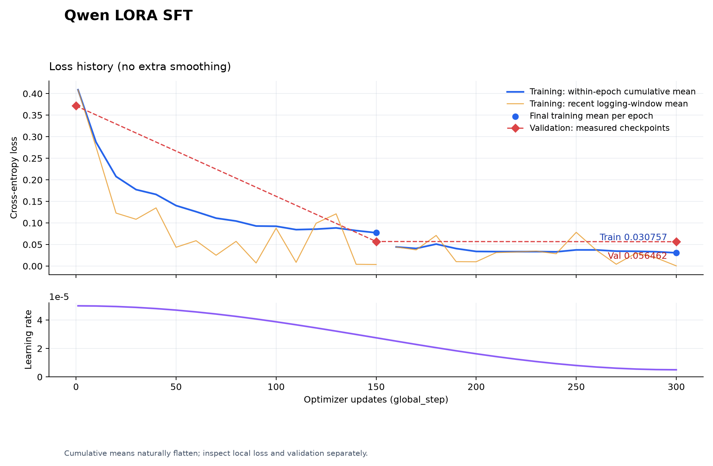

# TrainPilot 专项 LoRA V2 测试日志

| 项目 | 记录 |
| --- | --- |
| 评测日期 | 2026-10-22，北京时间 |
| 实验对象 | Qwen3-1.7B-Base 完成中文 Alpaca Full SFT 后，叠加 TrainPilot 专项 LoRA |
| 对照组 | 同一份 Full SFT 权重，关闭适配器 |
| 实验组 | 同一份 Full SFT 权重，启用 V2 适配器；不合并权重 |
| 当前状态 | 训练、独立生成评测、原 Agent 流程评测及问题消融均已完成 |
| 后续目标 | 优先保证本项目范围内的意图、字段、对象和状态转换正确；通用能力仅保留为观察项 |

## 1. 结论与适用范围

专项训练显著改善了结构化输出：139 条结构化独立测试中，完整 JSON 正确数从 **14 提高到 113**，意图正确数从 **113 提高到 133**，出现多余字段的样本从 **120 降到 3**。

但模型尚未稳定适应真实多轮流程。原 Agent 的一条四轮请假流程中，LoRA 正确完成追问信息和形成草稿，随后却错误处理确认与取消。单轮 12 题协议测试全部通过，不能代表完整任务已通过。

当前版本应保留为 **V2 对照基线**。下一阶段优先完善真实多轮数据、业务输出协议及任务验收，不直接追加 epoch，也不将通用能力回归作为主要优化目标。

本次运行没有连接业务数据库。正式提交、审批、撤销落库、知识库检索与引用正确性不在已验证范围内。四轮检查分数不是生产环境任务成功率。

## 2. 模型、数据与产物

### 2.1 权重定位与一致性

- Full SFT 权重：`E:\agent项目\trainpilot\runs\qwen-fullsft\checkpoint.pt`。
- V2 适配器：`E:\agent项目\trainpilot\runs\trainpilot_agent_lora_v2\adapter`。
- V2 训练断点：`E:\agent项目\trainpilot\runs\trainpilot_agent_lora_v2\checkpoint.pt`。
- 训练服务器的底座导出目录：`/home/u2023210704/TrainPilot-Qwen/runs/qwen_full_sft_24gb/model`。
- 本地评测底座来自上述已保存的 Full SFT 实验；不是重新下载原始 Qwen Base 来叠加适配器。
- 最终断点记录：`completed_epochs=2`，`global_step=300`。
- 最终断点与适配器文件的 **224 个张量逐项完全一致**。
- 评测前后，底座 checkpoint 与适配器文件 SHA256 均未改变。

| 文件 | SHA256 |
| --- | --- |
| Full SFT checkpoint | `365a5e036ed5cf69a51d0f27bd0586377fd1a731bb8410c79ec17ddf315029da` |
| adapter_model.safetensors | `77e7e6a47c448728163f0cfd7c7d0d4e33c0e776d26cf2ea3d00382b8d15c9b8` |
| V2 train.jsonl | `523d456c97c41bd71b2337da52326e778c5d7cf3a8623a42b893db30ea75030d` |
| V2 val.jsonl | `804ebabac2bd8f33d97562b5e3820885702687ae4728b0204a0ce8c13673acdc` |
| V2 test.jsonl | `632d5b09534721e69e668b004c5493c773b321296375c9620c1129b7dea702a0` |

权重继续保存在原 `runs` 路径；日志归档不重复复制权重或优化器状态。

### 2.2 数据与划分

| 划分 | 样本数 | 有效监督 token |
| --- | ---: | ---: |
| train | 1,200 | 35,842 |
| validation | 150 | 4,490 |
| test | 150 | 4,509 |

测试集含 139 条意图解析、7 条简单自然指令、4 条身份与职责问答。训练/测试、验证/测试的完全相同输入重合数、模板组重合数均为 0。但不同划分仍共享业务场景、协议和构造方法，不能据此认为已覆盖真实用户的所有表达。

### 2.3 训练配置与结果

| 配置 | 值 |
| --- | --- |
| 可训练参数 / 含适配器的总参数 | 6,422,528 / 1,726,997,504 |
| 目标投影 | q_proj、k_proj、v_proj、o_proj，28 层 |
| rank / alpha / dropout | 16 / 32 / 0.05 |
| optimizer | AdamW，weight_decay=0.01 |
| 参数 / 计算精度 | FP32 参数，BF16 混合精度计算 |
| batch / accumulation | 1 / 8，有效 batch 为 8 |
| max_length | 1536 |
| epoch / 更新次数 | 2 / 300 |
| learning rate | 5e-5，余弦下降至 5e-6 |
| gradient checkpointing | 启用 |
| 训练 GPU | RTX 4090 D |
| 峰值已分配显存 | 8,893.55 MiB |

| 时点 | train loss | validation loss |
| --- | ---: | ---: |
| 训练前 | — | 0.371502 |
| epoch 1 结束 | 0.077221 | 0.056978 |
| epoch 2 结束 | 0.030757 | 0.056462 |

两次短试训分别更新 10 步，随后从第 20 步继续至第 300 步。三次运行记录的训练、验证及导出耗时合计约 **522.52 秒**；其中最后一次为 **479.92 秒**。该合计不含各次模型加载、首次验证等全部部署墙钟开销，不作为硬件吞吐基准。

训练中曾因不稳定的 `datasets` 缓存 fingerprint 导致续训误拒绝。已修复为不比较这两个缓存标记，继续比较源数据 SHA256、模型路径和训练超参数；没有清空原断点或重新计数。



## 3. 评测方法与评分口径

- 本地 GPU：RTX 3060 Laptop，6GB；两组在同一进程共用底座，通过 `disable_adapter()` 切换。
- 两组都使用 BF16 推理、相同 tokenizer 和聊天模板、`enable_thinking=False`、贪心解码及 KV cache。
- 最大新增 token 为 256。两组各 198 条单模型生成中均未发生达到生成上限的截断。
- 服务器训练使用 FP32 参数配合 BF16 计算，本地将权重转为 BF16 推理；两组本地对照的条件相同。
- 测试题和标签在生成前固定；不调用外部模型 API，也不调用外部模型作为裁判。
- JSON 合法只表示原文能解析为对象，不等于字段类型、意图及内容均正确。
- 完整 JSON 正确要求意图、字段、字段值与标签一致，不修补输出、不删除多余字段。
- 4 条身份与职责问答保留原文人工评阅，不用“是否出现 TrainPilot”统一判定；缺失信息问题没有必要重复自称。
- 6 条通用开放题不计入自动通过数。通用题为历史观察项，不作为后续项目训练的主要验收门槛。

## 4. 独立业务测试结果

### 4.1 主要指标

| 指标 | Full SFT | Full SFT + LoRA V2 |
| --- | ---: | ---: |
| 结构化样本数 | 139 | 139 |
| JSON 对象可解析 | 139/139 | 139/139 |
| 意图正确 | 113/139，81.29% | 133/139，95.68% |
| 字段对象完全正确，不单独要求意图正确 | 18/139，12.95% | 116/139，83.45% |
| 完整 JSON 正确 | 14/139，10.07% | 113/139，81.29% |
| 出现多余字段的样本 | 120 | 3 |
| 7 条简单自然指令完全匹配 | 2/7 | 7/7 |
| 150 条测试样本的 teacher-forced loss | 0.399317 | 0.062404 |
| 对应 PPL | 1.490806 | 1.064392 |
| teacher-forced token 准确率 | 88.60% | 98.67% |

teacher forcing 使用正确答案前缀预测后续 token；98.67% 的 token 准确率不等于 98.67% 的任务成功率。低 PPL 主要描述当前短答案、结构化协议分布，不能当成通用语言模型 PPL。

### 4.2 关键场景的严格匹配

| 类别 | Full SFT | LoRA V2 |
| --- | ---: | ---: |
| 制度问题 policy_qa | 1/11 | 11/11 |
| 待审批查询 query_pending | 0/5 | 5/5 |
| 完整请假 leave_full | 0/10 | 9/10 |
| 缺少日期 missing_dates | 0/4 | 4/4 |
| 缺少原因 missing_reason | 0/4 | 4/4 |
| 缺少全部信息 missing_all | 0/4 | 4/4 |
| 确认当前动作 confirm_action | 0/8 | 2/8 |
| 取消当前草稿 cancel_action | 7/8 | 8/8 |
| 修改历史申请 history_modify | 0/8 | 4/8 |
| 审批 approve | 0/8 | 3/8 |
| 草稿存在时撤销另一申请 pending_cancel_existing | 0/6 | 5/6 |
| 获取建议 get_suggestion | 0/5 | 3/5 |

上述类别来自有限构造模板，不能把某类 8/8 当作所有自然表达均正确。真实流程中的“算了，取消草稿”仍然失败，见第 5 节。

### 4.3 代表性实际输出

**缺少请假信息，原 Agent 单轮题。**

用户：`我想请假`

LoRA 输出：

```json
{"intent":"submit_leave","extracted_info":{}}
```

未自行填入类型、日期或原因，符合当前协议。

**审批建议，独立测试 `test-get_suggestion-0001`。**

用户：`在真正审批之前，请就leave_bcf286f0a236给出建议。`

LoRA 实际输出：

```json
{"intent":"get_suggestion","extracted_info":"leave_bcf286f0a236"}
```

意图正确，但 `extracted_info` 被输出为字符串，预期为 `{"app_id":"leave_bcf286f0a236"}`。这是可解析 JSON，仍然不满足字段协议。

**操作对象混淆，独立测试 `test-pending_cancel_existing-0002`。**

用户：`请对现存已提交申请leave_98827c1879be发起取消，当前草稿并非这句话的对象。`

预期：

```json
{"intent":"delete_application","extracted_info":{"app_id":"leave_98827c1879be"}}
```

LoRA 实际输出：

```json
{"intent":"delete_application","extracted_info":{"app_id":"leave_aff7cf87550d"}}
```

意图正确，但取成了上下文中的其他编号。业务执行需要优先保证操作对象正确，不能仅凭意图准确率判定可用。

## 5. 原 Agent 单轮与多轮流程

### 5.1 原有 12 题单轮回归

| 指标 | Full SFT | LoRA V2 |
| --- | ---: | ---: |
| 意图正确 | 11/12 | 12/12 |
| 完整协议 JSON 正确 | 4/12 | 12/12 |
| 有 system 身份说明时自称 TrainPilot | 2/2 | 2/2 |
| 无 system 身份说明时自称 TrainPilot | 0/2 | 0/2 |

LoRA 在没有身份说明的“你是谁？”题中仍回答“我是一个人工智能助手，由 OpenAI 开发……”。项目部署应保留明确的 TrainPilot system 身份说明；不将无提示身份固化作为当前业务适配的首要任务。

### 5.2 一条四轮请假流程

| 轮次 | 用户输入 | Full SFT | LoRA V2 |
| --- | --- | --- | --- |
| 1 | 我想请事假 | 错误填入当天日期和“请假”原因，直接形成草稿；失败 | 仅提取事假，追问时间与原因；通过 |
| 2 | 时间是2026年11月2日到11月3日，原因是个人事务。 | 正确形成草稿；通过 | 正确形成草稿；通过 |
| 3 | 确认提交 | confirm_action，进入确认执行路由；通过 | submit_leave，重复形成草稿；失败 |
| 4 | 算了，取消草稿 | cancel_action，清除草稿；通过 | delete_application，草稿未清除；失败 |

检查点计数为 **3/4 → 2/4**，两组均没有完整通过该四轮检查。不能因此简单认定原模型整体更好：原模型首轮存在编造，LoRA 改善了该问题，但后续状态转换失败。

LoRA 首轮实际给用户的回复：

```text
请提供以下信息：
- 请假时间（格式：2026-06-23 到 2026-06-28）
- 请假原因
```

第二轮正确草稿为：

```json
{"leave_type":"事假","start_date":"2026-11-02","end_date":"2026-11-03","working_days":2,"reason":"个人事务","requires_hr":false}
```

`working_days`、`requires_hr` 是业务程序计算的状态字段，不是要求模型生成的 7 个提取字段之一。第三轮模型却把这些字段也复制进了 `extracted_info`，说明它尚未稳定区分系统状态与本轮语义输出。

测试使用原 LangGraph 的意图识别、路由、草稿、回复与状态链路；依赖数据库的节点统一返回未接入提示，没有执行真实写操作。原始节点轨迹及回复已归档。

## 6. 失败类型、消融与原因分析

### 6.1 26 条结构化失败的分类

| 类型 | 数量 | 处理重点 |
| --- | ---: | --- |
| 意图混淆 | 6 | 确认提交被识别为申请或审批 |
| 漏字段 | 6 | 历史原因或审批意见未输出；需结合业务合并规则判断影响 |
| 字段值或文本边界不一致 | 11 | 假别规范化、原因和意见的抽取范围 |
| 操作对象编号错误 | 1 | 当前草稿与另一已提交申请的对象区分 |
| 字段结构类型错误 | 2 | extracted_info 输出成字符串 |

11 条边界或值不一致不全部等价于严重语义错误。例如“身体不适”被提取为“处理身体不适”，与构造句“缺勤处理身体不适”本身不自然有关；但“产假”被输出为“休产假”也可能影响业务枚举校验。历史严格成绩不变，后续应区分结构化枚举精确匹配与自由文本的业务可接受性。

### 6.2 数据覆盖的直接证据

- 56 条确认训练样本、56 条取消训练样本，**有对话历史的均为 0 条**。
- 这些样本的草稿只包含 4 个请假字段，真实草稿还带有业务程序计算的字段。
- 24 条身份训练样本全部带 system 身份说明；无提示身份题没有显示出适配收益。
- V2 主要验证了有限模板下的协议学习，尚不足以代表真实工作流轨迹分布。这是本版数据构造的不足。

### 6.3 两个实际失败请求的对照消融

同一 LoRA、同一贪心生成设置，只改变提示词中的历史或草稿字段，未重新训练。

| 输入变体 | “确认提交”的意图 | “算了，取消草稿”的意图 |
| --- | --- | --- |
| 保留完整实际上下文 | submit_leave，错误 | delete_application，错误 |
| 仅移除历史，保留真实草稿字段 | confirm_action，正确 | delete_application，错误 |
| 保留历史，仅将草稿缩减为 4 个字段 | submit_leave，错误 | delete_application，错误 |
| 移除历史并缩减草稿字段 | confirm_action，正确 | delete_application，错误 |

对这次确认请求，历史内容改变了结果；仅删掉草稿扩展字段没有修复。取消请求在所有变体中仍失败，说明还存在表达与意图边界覆盖不足，不能把所有问题都归因于历史。

这些是两个固定请求的诊断证据，不能外推为所有失败的唯一原因。删除线上历史也不是解决方案，否则会破坏补充、修改和指代任务。

### 6.4 评测协议与项目任务需要进一步对齐

已核对 Agent 的 `app/workflows/chat_nodes/leave.py`，请假节点会执行：

```python
merged = {**accumulated, **extracted_info}
```

因此，模型在修改日期时没有重复输出已保存的原因，虽然不符合 V2 的完整字段标签，**不一定使最终业务状态错误**。这部分需要携带真实 `conversation_context` 重新执行流程后判断，不能直接将全部漏字段认定为项目失败。

下一版应先明确模型输出“本轮新增/修改字段”还是“合并后的完整字段”。当前记录不修改 V2 标签、不改历史成绩，也未自动更改业务协议。

## 7. 下一阶段实施顺序

| 顺序 | 工作 | 交付物与完成条件 |
| --- | --- | --- |
| 0，已完成 | 固定 V2 基线 | 保留原权重、数据、训练记录、全部测试原文和本日志，后续实验使用新目录 |
| 1 | 与 Agent 逻辑对齐业务契约 | 确定 11 种意图、7 个提取字段、字段类型、缺失信息、确认/取消对象、字段合并与任务切换规则 |
| 2 | 先展示 V3 少量真实多轮样例 | 使用实际工作流格式的 history、pending_action 和用户输入；展示输入、预期 JSON、预期节点和下一状态，经用户确认后再批量构造 |
| 3 | 建立完整任务评测 | 覆盖追问→补齐→修改→确认/取消，以及草稿与另一申请同时存在；按任务/表达分组隔离训练、验证、测试 |
| 4 | 构建并检查 V3 专项数据 | 覆盖真实助手回复、长短历史、不同确认/取消表达和干扰对象；审查不自然句子、文本边界及类型，不靠改日期/编号扩充独立场景数量 |
| 5 | 进行可比较的新 LoRA 实验 | 建议从同一 Full SFT 底座新建适配器，保留 V2；先固定训练配置研究数据收益，再单独比较超参数 |
| 6 | 接回完整业务环境验收 | 先验证无数据库状态流程，再在可控测试数据库上验证提交、审批、撤销、结果回传和知识检索，不将当前未接数据库的结果当作已完成业务验收 |

若确需改变协议，应保存新协议版本，并让 Full SFT、V2、V3 在同一新协议下重新评测；不能直接比较不同协议的分数来宣称模型提升。

### 下一版验收重点（建议，尚未实施）

- **主要指标：**完整场景通过率、正确路由、关键字段和操作对象准确性、确认/取消后的状态正确性。
- **关键错误阻断：**冻结的验收场景中，不出现错误对象操作、把取消当审批、未确认就执行或编造已执行结果。有限验收集通过不等于所有输入下都保证正确。
- **格式要求：**字段类型符合契约；未知字段不编造；缺信息进入追问或澄清。
- **文本字段：**明确原因、意见允许的语义等价范围，不将无关句式差异与错误日期、编号混为一类。
- **身份要求：**在实际项目 system 设置下统一自称 TrainPilot，并正确说明权限和执行边界。
- **框架配合：**已有的状态合并、工作日计算、权限校验与确认执行由业务代码承担；模型负责理解、提取与组织回答。模型原始成绩与框架约束后的任务成绩分开记录。
- **通用题：**保留为观察，不因无关通用分数下降阻止业务版本推进；与业务相关的日期、否定、对象和指代理解仍属于任务验收。

下一项具体工作是 **对齐输出与状态契约，并给用户展示 V3 多轮样例**。本次没有自动构造 V3 数据、修改 Agent 业务代码或启动新训练。

## 8. 通用能力观察（非主要优化目标）

通用客观题严格通过数为 23/42 → 33/42。忽略句末标点后，8 条逻辑题内容正确数为 8/8 → 6/8。严格分数提高包含格式改善，不能解释成推理能力普遍提高。

例如“所有猫都怕水，小白怕水，能否确定小白是猫？”原模型回答“不能。”，LoRA 回答“能”。该回归保留为事实记录，后续资源优先投入本项目任务；业务否定和条件判断则应使用业务场景继续检验。

## 9. 归档、原始结果与复现

完整证据快照目录：`trainpilot_agent_v2_20261022/`。该目录不含权重、优化器或密钥，训练权重仍保留在第 2 节的原路径。

| 文件/目录 | 内容 |
| --- | --- |
| [comparison.json](trainpilot_agent_v2_20261022/comparison.json) | 两组指标、产物检查、数据审计与消融摘要 |
| [snapshot_manifest.json](trainpilot_agent_v2_20261022/snapshot_manifest.json) | 本次归档各文件的 SHA256 与来源 |
| [cases.json](trainpilot_agent_v2_20261022/cases.json) | 生成前固定的业务与通用题 |
| [sft_generations.jsonl](trainpilot_agent_v2_20261022/sft_generations.jsonl) | 对照组全部 198 条输出、生成 token、停止原因及评分 |
| [lora_generations.jsonl](trainpilot_agent_v2_20261022/lora_generations.jsonl) | LoRA 组全部 198 条输出及评分 |
| [failure_analysis.json](trainpilot_agent_v2_20261022/failure_analysis.json) | 26 条结构化失败的完整输入、预期和实际输出 |
| [workflow_ablation.json](trainpilot_agent_v2_20261022/workflow_ablation.json) | 两个请求的 8 次消融及完整上下文 |
| [agent_sft/agent_results.jsonl](trainpilot_agent_v2_20261022/agent_sft/agent_results.jsonl) | 对照组身份、12 题意图及四轮节点轨迹 |
| [agent_lora/agent_results.jsonl](trainpilot_agent_v2_20261022/agent_lora/agent_results.jsonl) | LoRA 组实际节点轨迹、草稿及用户可见回复 |
| [model_metadata.json](trainpilot_agent_v2_20261022/model_metadata.json) | 底座、适配器、配置、精度与评测前后哈希 |
| [training/metrics.jsonl](trainpilot_agent_v2_20261022/training/metrics.jsonl) | 三次运行的更新、验证及保存记录 |
| [training/run_manifest.json](trainpilot_agent_v2_20261022/training/run_manifest.json) | 服务器实际训练参数 |

评测入口：[evaluate_agent_lora.py](../../test_code/evaluate_agent_lora.py)。保留原 `runs` 输出，复现时使用新的结果目录避免覆盖：

```powershell
cd E:\agent项目\trainpilot
.\.venv\Scripts\python.exe -u -m test.test_code.evaluate_agent_lora --output-dir runs/lora-eval-rerun
```

该命令需要足够的本地空闲显存；若已有模型接口占用显存，应先处理该占用，不重复加载两份底座。真实 Agent 回归入口为同学项目的 `local_runtime.evaluate_agent_model`，两组别名分别为 `trainpilot-sft` 与 `trainpilot-lora`。

记录口径：身份题评分错误已修正为待人工评阅，原先的名称检查结果保存在原始行的 `original_automatic_name_check` 字段中；139 条结构化严格成绩不受影响。原始模型文本未修补，未把评测题加入训练数据。本日志及证据已写入本地，未自动提交或推送 GitHub。
